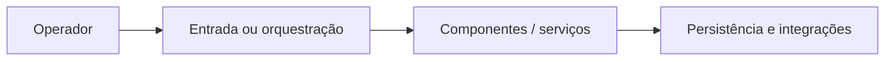

# Arquitetura — Sistema-de-rastreamento-de-veiculos---Curso-Full-Cycle-2.0-

Stack identificada: Docker Compose, Go, NestJS, Next.js, Kafka e MongoDB. Locais de referência: docker-compose.yaml, .gitmodules, mongodb/.

Este é um diagrama **conceitual**, não descreve todos os processos reais. Não reestruturar o projeto antes de validar contratos e dependências.

Este repositório depende de submódulos e serviços relacionados. Não assumir que Docker Compose é seguro para produção.
